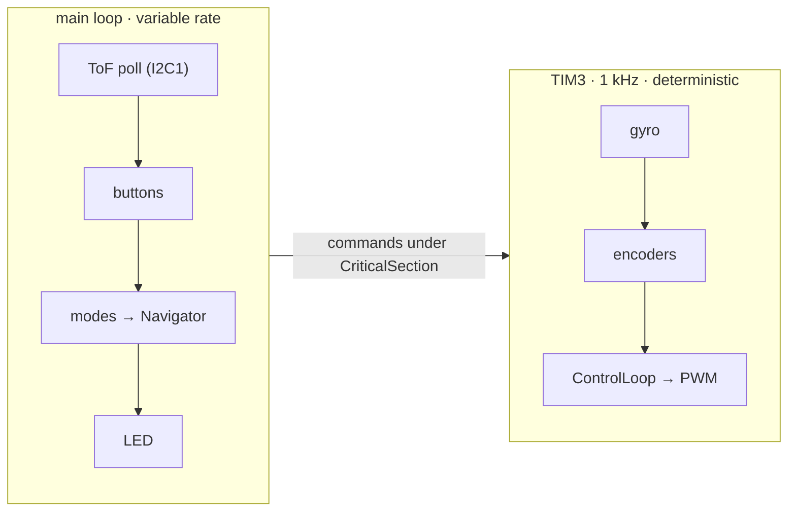
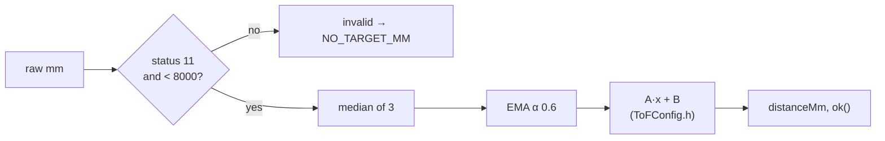
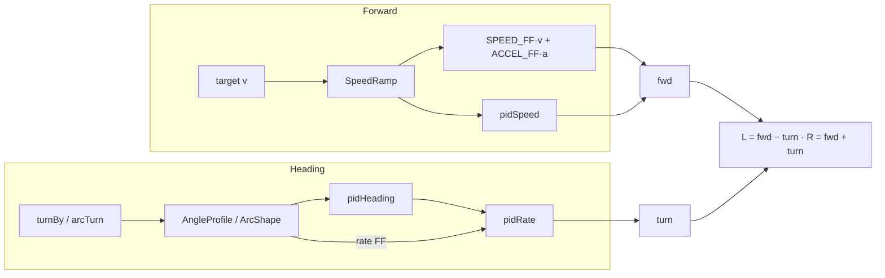
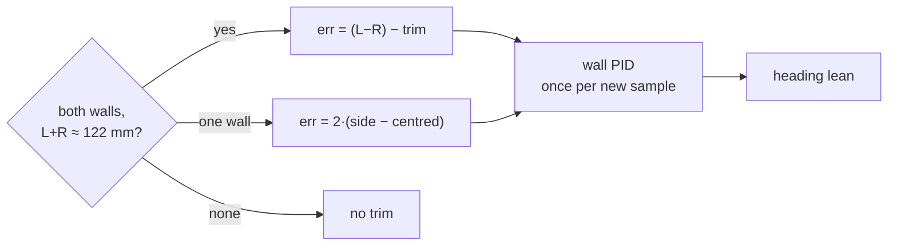
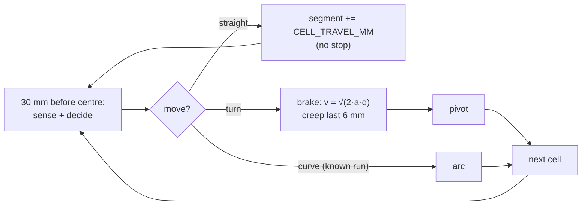
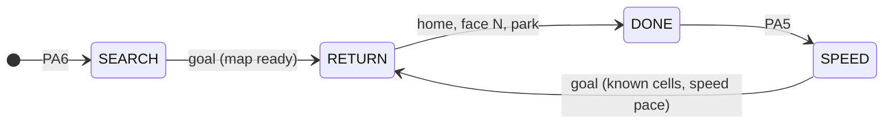
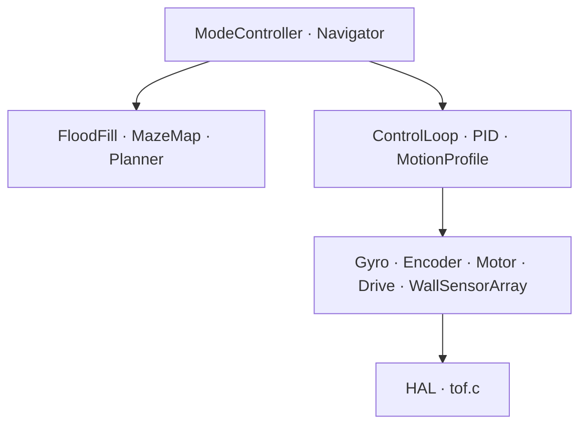
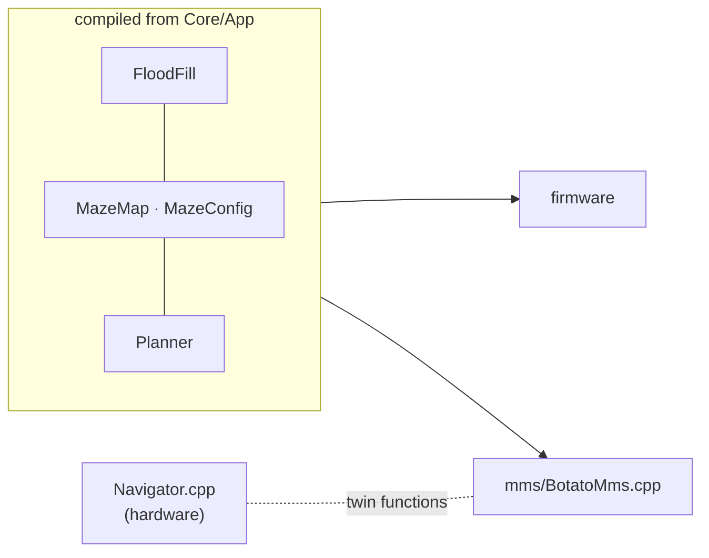

# 🐭 BOTATO — Software Architecture Decisions

Why the firmware is built the way it is. Read with [`PINOUT.md`](PINOUT.md) before changing
anything. Each entry: **decision**, **why**, and, where a decision was revised, what it replaced.

---

## Timing and interrupts

### 1. Nothing unbounded runs in an ISR
**Decision:** the TIM3 ISR does only fixed-length work (gyro read, encoders, control). ToF I2C,
flood fill and maze decisions stay in the main loop.
**Why:** the PIDs assume an exact 1 ms `dt`; anything that can stretch a tick adds jitter.

### 7. One master clock: TIM3 at 1 kHz
**Decision:** gyro, encoders, PID and PWM all run off TIM3. Navigation runs at main-loop rate.
**Why:** one clock means no drift between subsystems (an early parallel DWT timer was removed).



### 34. SysTick pre-empts the control ISR
**Decision:** `Robot::initCore()` sets SysTick = 0, TIM3 = 1 (overriding the `.ioc`'s 15 / 0).
**Why:** TIM3 reads I2C2 and HAL timeouts count SysTick; below TIM3 a stuck bus would hang forever.

---

## Sensors

### 2. ToF: continuous mode, polled — REVISED
**Decision:** sensors free-run (20 ms budget, ~45 Hz) and `WallSensorArray::poll()` reads them
non-blockingly. GPIO1 data-ready is not wired; no EXTI.
**Why:** a free-running sensor always holds its latest result, so an interrupt adds no information.
*Replaced:* one EXTI per sensor. The leftover EXTI0–4 config was removed from the `.ioc`.



### 3. MPU6050: read every tick, no interrupt
**Decision:** one Z-gyro read per 1 ms tick on I2C2; INT pin unconnected.
**Why:** the sensor updates at a fixed rate, so INT would fire exactly when we read anyway.
*Replaced:* reading every 5th tick, which quantised the inner rate loop.

### 4. Encoders: hardware quadrature on 32-bit timers
**Decision:** TIM5 (left) and TIM2 (right) in encoder mode, no ISR; speed is a 4-tick average.
**Why:** zero CPU cost and no overflow handling (the only two 32-bit timers on the F411).

### 11. Gyro calibration runs inside the ISR — REVISED
**Decision:** ±500 °/s (65.5 LSB/°/s), DLPF ~44 Hz, 5 s bias calibration, all I2C2 traffic in
`Gyro::update()`. 100 failed reads in a row = gyro lost → fault.
**Why:** a blocking calibration in the main loop collided with ISR reads and froze the LED.
Recalibrate warm, just before a run (PA6 long): the bias drifts with temperature.

### 16. Two I2C buses
**Decision:** five ToF on I2C1 (PB6/PB7), MPU6050 alone on I2C2 (PB10/PB9).
**Why:** five 10 kΩ pull-ups in parallel loaded a shared bus below what the MPU6050 could drive.

```
 shared bus:  ToF ×5 ∥ MPU6050 pull-ups ≈ 1.5 kΩ  →  MPU6050 can't pull low  ✗
 split:       I2C1 ToF ×5 ≈ 2 kΩ   │   I2C2 MPU6050 alone  ✔
```
**Trap:** PB9 is I2C2_SDA only at **AF9**; at AF4 it stays on I2C1 and fails silently.

### 18. Right encoder negated in software
**Decision:** right count and delta are negated together. **Why:** the encoders are mirrored on the
chassis; fixing it in the `.ioc` would disturb a verified config.

### 27. Validity is a first-class signal
**Decision:** `ok(i)` = fresh and in range. Invalid or stale (80 ms) reads `NO_TARGET_MM` (8190),
never 0. **Why:** a stale 0 once read as "wall on the nose" and ended a cell after 10 mm.

---

## Actuation and control

### 5. Motor PWM in hardware
**Decision:** TIM1, 20 kHz, one register write per update; dead-band 500. **Why:** silent, zero CPU.

### 15. Motor polarity inverted inside `Motor`
**Decision:** direction pins are inverted vs the TB6612 truth table, handled only in `Motor`.
**Why:** matches this board's wiring; nothing above the motor layer needs to know.

### 23. Profiles, feed-forward, then PID; one authority per axis
**Decision:** every command passes through a profile; feed-forward does most of the work and the
PIDs only correct.


**Why:** the clamped speed integral can't hold a speed on its own; `ACCEL_FF` cancels motor lag that
made every stop overshoot. Heading → gyro only; distance → front ToF else encoders; lateral →
side ToF. They never vote on the same question.

| Gains (`ControlConfig.h`) | kp | ki | kd | i clamp |
|---|---|---|---|---|
| `SPEED` | 4.0 | 0.15 | 0 | 400 |
| `RATE` | 10.0 | 0 | 25 | 400 |
| `HEADING` | 8.0 | 0 | 5 | 200 |

### 26. Speed limits; steering keeps priority — REVISED
**Decision:** targets stay under free-run (~695 mm/s); `DifferentialDrive` reduces forward PWM
instead of clipping one wheel.

```
 clipping (old):  fwd 4999 + turn → right clamped, left not  → one-sided steering ✗
 desaturate:      fwd reduced to 4999 − |turn|               → both sides keep turn ✔
```
**Why:** one-sided clipping looked like a gyro or PID fault.

### 28. Lateral centring trims the heading setpoint
**Decision:** side-wall error → wall PID → small heading lean (≤ 12°) via `setHeadingTrim()`.
**Why:** adding it to the rate target fought heading-hold and left a constant offset.


Gates: away from posts, moving, reading in band. Open sides in the map are never followed; an
unexplored wall that ends (jump or out of band) latches that side off until the next cell.

---

## Heading

### 21. Heading conventions
1. Anticlockwise-positive: left +90, right −90, around +180, in `Planner::turnDegrees()` only.
2. `Planner::turnFor()` is purely geometric (`Dir` clockwise N=0 E=1 S=2 W=3).
3. **Nothing is wrapped**, neither the gyro angle nor the heading error.
4. Turns are relative (`turnBy`); `resetForRun()` makes heading 0 = NORTH.

### 22. A single 180° turn is safe — REVISED
**Decision:** `TURN_AROUND` = one `turnBy(+180)`.
*Replaced:* two 90° turns, because the old wrapped error put +180 on the ±180 boundary:

```
 wrapped (old):   err 180.5 → −179.5 → turns CW   │   err 179.5 → turns CCW   (noise picks) ✗
 continuous:      goal = angle + 180              → always CCW                             ✔
```
If wrapping is ever reintroduced, go back to two 90° steps.

### 24. Dead ends: single pivot, not a K-turn — REVISED
**Decision:** dead ends pivot 180° on the cell centre like any other turn.
**Why:** the current body (85 × 81.5 mm, axle 29.5 mm from the rear) sweeps a ~69 mm radius, inside
the 90 mm half-corridor. *Replaced:* a multi-point K-turn needed by the old 120 mm chassis.

```
  ┌──────── 180 mm ────────┐
  │      ╭─ r ≈ 69 ─╮      │   swept circle fits with ~21 mm to spare
  │      │    ●     │      │
  │      ╰──────────╯      │
```

---

## Navigation

### 25. Segment model — REVISED
**Decision:** decisions and turns happen with the axle on a cell centre. The robot drives to a
target centre; 30 mm before it (side ToF over the centre) it senses and decides.


**Why:** segment ends advance by exactly one cell, so error can't compound; every front-wall stop
re-anchors from the ToF (lag-compensated 47 ms). A stall guard ends a creep that stops moving.
*Known gap:* the grid pose is still dead reckoning.

### 29. The goal is a bounding box
**Decision:** `GOAL_X/Y_MIN..MAX` (7–8, 7–8); entering any cell counts.
**Why:** the goal has one entrance, so stopping at the first cell is fastest. `y = 0` is the bottom
row: the centre is symmetric, the start corner is not (#30).

### 30. Start corner: configured, then detected
**Decision:** `START_X = WIDTH − 1` (maze on the left). A valid side reading > 200 mm where the
map has the outer wall proves it's the other side; the start column is copied across.
**Why:** a wrong guess about the corner should cost nothing.

### 31. Every run drives home; speed runs trust the map


**Why:** lifting the robot costs +20 s (rule 2.4.6.2), and parking gives every run the same start.
Speed runs use visited cells only and never sense, so a glitch can't add a false wall.

### 8. Flood fill is hardware-free
**Decision:** `FloodFill`, `MazeMap`, `Planner` have no HAL dependencies and run in the main loop.
**Why:** they can be tested off-board; the mms simulator compiles them directly (#32).

---

## Structure and tooling

### 12. C++17 application, C vendor code — REVISED
**Decision:** C++ for structure only: no exceptions, RTTI or dynamic allocation; HAL and `tof.c`
stay C. A `Robot` facade owns every subsystem and wires them through `init()`.
**Why:** RAM and timing identical to C, with clearer ownership. *Replaced:* "OOP-style C".
**Rules:** HAL headers inside `extern "C"`; never forward-declare HAL typedefs.

### 20. Layer boundaries


**Decision:** dependencies point down only. Calling HAL from `Navigator` or deciding in `Motor`
means something is in the wrong layer.

### 17. Test build — REVISED
**Decision:** `BOTATO_TEST_BUILD` (Config.h) + exactly one `TEST_*` in `main_test.cpp`
(`#error` otherwise). Each test fills one `volatile` report struct for Live Expressions.
**Why:** competition `main.cpp` stays clean, and unused tests cost nothing (`--gc-sections`).
*Replaced:* defines in `main.cpp` and raw member watches.

### 32. mms compiles the firmware's maze code


**Rule:** search-policy changes in `Navigator.cpp` must be mirrored in the `twin of Navigator::`
functions in `BotatoMms.cpp`.

### 33. Faults stop the robot and say why
**Decision:** `FAULT` stops the motors and flashes a code: **2** gyro not found, **3** gyro lost,
**4** no 1 kHz tick. PA6 long retries. `Error_Handler` zeroes PWM, LED solid.
**Why:** each code points at a physical cause instead of a silent hang.

### 14. Git workflow
AI assistants never `git add`, `commit`, `push` or branch. The owner commits.

---

## History

| # | Note |
|---|---|
| 6 | Buttons are polled, not EXTI: PA5/PA6 share `EXTI9_5`, and bouncing contacts flood interrupts. |
| 9 | No AFIO remap: the F411 has no AFIO; `Debug = Serial Wire` frees PA15. |
| 10 | PB6/PB7 were once reserved for a UART; now I2C1. No debug UART exists. |
| 13 | Project restarted from a verified-clean `.ioc` after inconsistent early state. |

## Hardware status (#19)

| Subsystem | Status |
|---|---|
| I2C1 + 5× ToF, calibration · I2C2 + MPU6050 · encoders · motors · buttons | ✅ |
| Heading hold, 90° pivots, cell drive, wall sensing | ✅ |
| Single 180° pivot · search → return → park · speed run | Implemented — record results |
| Curved turns | Tuned on open floor (`TEST_CURVE`); off by default |

No VMOT decoupling capacitor is fitted: if faults appear only while driving, suspect PWM noise.

---

## Summary

| # | Area | Decision |
|---|---|---|
| 2 | ToF | Continuous, polled; GPIO1 not wired |
| 3 | IMU | Read every TIM3 tick |
| 4 | Encoders | Hardware quadrature |
| 7 | Timing | Single TIM3 @ 1 kHz |
| 12 | Language | C++17, no exceptions / RTTI / allocation |
| 16 | I2C | Two buses |
| 21–22 | Heading | Gyro only, relative, never wrapped; single 180° |
| 23 | Control | Profile + feed-forward + PID |
| 24 | Dead ends | Single pivot |
| 25 | Cells | Segment model, front-wall re-anchor |
| 28 | Centring | Trims heading setpoint |
| 31 | Runs | Always drive home; speed runs on known cells |
| 34 | NVIC | SysTick above TIM3 |

*Update this file when a decision is made or revised; mark revisions instead of deleting history.*
