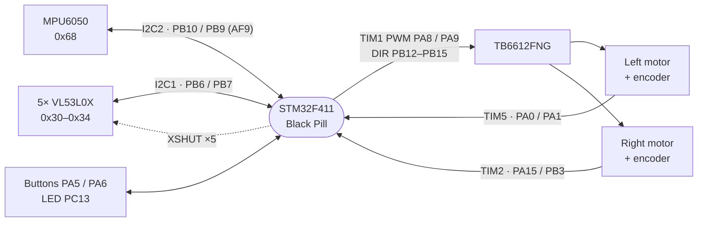
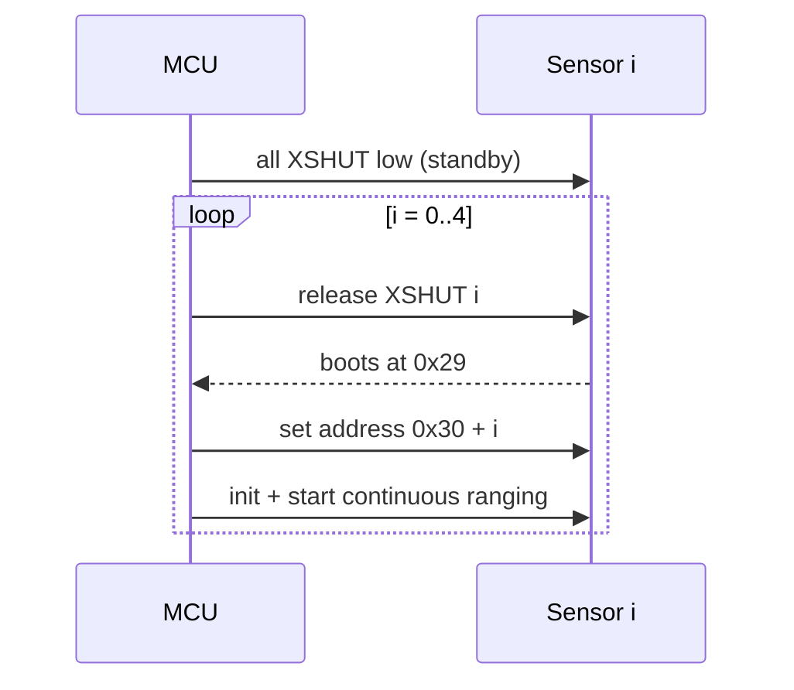
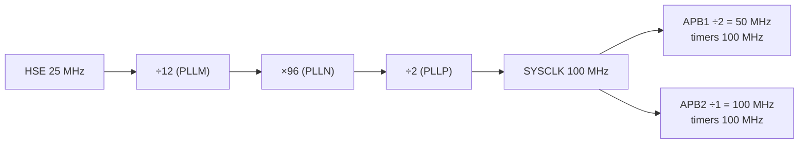

# 🐭 BOTATO — Hardware Pinout & Peripherals
### STM32F411CEU6 · University of Moratuwa · REV 2.0

Verified against the `.ioc` and the physical wiring: treat every value here as ground truth.
Software reasoning lives in [`DECISIONS.md`](DECISIONS.md).

| MCU | |
|---|---|
| Part / board | STM32F411CEU6, UFQFPN48, Black Pill |
| Firmware package | STM32Cube FW_F4 V1.28.3 |
| Toolchain | GCC, C++17 `-fno-exceptions -fno-rtti -fno-use-cxa-atexit`, hard FPU `fpv4-sp-d16` |

---

## 1. Wiring overview



## 2. Pin map

| Pin | Function | | Pin | Function |
|---|---|---|---|---|
| PA0 | Left encoder A (TIM5_CH1) | | PB3 | Right encoder B (TIM2_CH2) |
| PA1 | Left encoder B (TIM5_CH2) | | PB4 | ToF LeftFront XSHUT |
| PA5 | BTN1 "fast" (input, pull-up) | | PB5 | ToF Front XSHUT |
| PA6 | BTN2 "search" (input, pull-up) | | PB6 | I2C1 SCL (AF4) |
| PA7 | ToF RightFront XSHUT | | PB7 | I2C1 SDA (AF4) |
| PA8 | Left PWM (TIM1_CH1) | | PB8 | ToF Right XSHUT |
| PA9 | Right PWM (TIM1_CH2) | | PB9 | I2C2 SDA (**AF9**) |
| PA10 | ToF Left XSHUT | | PB10 | I2C2 SCL (AF4) |
| PA13 / PA14 | SWDIO / SWCLK | | PB12 / PB13 | AIN1 / AIN2 (right dir) |
| PA15 | Right encoder A (TIM2_CH1) | | PB14 / PB15 | BIN1 / BIN2 (left dir) |
| PC13 | Status LED (active LOW) | | | |

**Unassigned:** PA2, PA3, PA4, PA11, PA12, PB0, PB1, PB2, PC14, PC15. The ToF GPIO1 (data-ready)
lines are **not wired**; no EXTI is enabled.

> ⚠️ **PB9 must be AF9** under I2C2 (AF4 would leave it on I2C1). Check `GPIO_AF9_I2C2` in
> `HAL_I2C_MspInit`. ⚠️ **XSHUT_RIGHT is PB8**, not PB10 (that's I2C2 SCL).

---

## 3. ToF sensors (I2C1)

```
            front
     LF ◤    F ▲    ◥ RF        lens ahead of the axle:
         ╲   │   ╱                F 56 mm · LF/RF 47 mm · L/R 30 mm
   L ◀────[ BOTATO ]────▶ R
          ●═══════●             ● wheels on the axle, wheelbase 75.4 mm
```

| Sensor | Index | XSHUT | Address |
|---|---|---|---|
| Left | 0 | PA10 | `0x30` |
| LeftFront | 1 | PB4 | `0x31` |
| Front | 2 | PB5 | `0x32` |
| RightFront | 3 | PA7 | `0x33` |
| Right | 4 | PB8 | `0x34` |

XSHUT pins are **open-drain, no pull** (sensor logic is 2.8 V: pull low or release, never drive
3.3 V). Addresses live in sensor RAM, so the sequence runs at every boot:



---

## 4. I2C buses

```
 I2C1  PB6/PB7  400 kHz ──┬── ToF L ── ToF LF ── ToF F ── ToF RF ── ToF R   (5 × 10 kΩ ≈ 2 kΩ)
 I2C2  PB10/PB9 400 kHz ──┴── MPU6050 only                                  (board pull-ups)
```

Split because the five ToF pull-ups in parallel loaded a shared bus below what the MPU6050 can
drive (DECISIONS #16). All pull-ups are on the breakouts: **a dead 3.3 V sensor rail silences
both buses** — measure it before suspecting firmware.

| MPU6050 | |
|---|---|
| SCL / SDA | PB10 / PB9 (I2C2) |
| AD0 | GND → `0x68` |
| INT, XDA, XCL | not connected |

---

## 5. Motors and encoders

```
          PWM (TIM1)      direction            TB6612 out         motor
 Left   PA8  CH1 ──┐   BIN1 PB14 BIN2 PB15 ──▶ B_OUT1 → M2, B_OUT2 → M1   left
 Right  PA9  CH2 ──┘   AIN1 PB12 AIN2 PB13 ──▶ A_OUT1 → M1, A_OUT2 → M2   right
 STBY hardwired to 3.3 V · direction polarity inverted in Motor (DECISIONS #15)
```

| Encoder | A (CH1) | B (CH2) | Timer |
|---|---|---|---|
| Left | PA0 | PA1 | TIM5, 32-bit, TI12 |
| Right | PA15 | PB3 | TIM2, 32-bit, TI12 (negated in software, #18) |

PA15 needs no remap: `Debug = Serial Wire` frees it (the F411 has no AFIO).

| Drivetrain (`Config.h`) | Value |
|---|---|
| Encoder | 7 PPR × 50:1 × 4 = 1400 counts / wheel rev |
| Wheel | 44.26 mm effective → 0.0993 mm/tick |
| Wheelbase | 75.4 mm |
| Free-run | 300 rpm ≈ 695 mm/s (search 350, speed 625, curves 300) |

| Body (`Config.h`) | Value |
|---|---|
| Length × width | 85.2 × 81.5 mm |
| Axle to front / rear | 55.7 / 29.5 mm |

---

## 6. Clocks, timers, interrupts



| Timer | Role | Config | ISR |
|---|---|---|---|
| TIM1 | Motor PWM | PSC 0, ARR 4999 → 20 kHz | — |
| TIM2 | Right encoder | TI12, 32-bit | — |
| TIM3 | Control loop | PSC 99, ARR 999 → 1 kHz | ✔ |
| TIM5 | Left encoder | TI12, 32-bit | — |

| Interrupt | `.ioc` | Runtime (`Robot::initCore`) |
|---|---|---|
| SysTick | 15 | **0** |
| TIM3 | 0 | **1** |

SysTick is raised above TIM3 so HAL I2C timeouts still advance inside the ISR (DECISIONS #34).

---

## 7. Power

```
 Battery ─┬─ MP1584EN #1 → 6 V   → TB6612 VMOT (motors)
          └─ MP1584EN #2 → 3.3 V → MCU · 5× ToF · MPU6050 · TB6612 VCC · encoders
```

> ⚠️ No decoupling capacitor across VMOT. If sensor faults appear only while driving, suspect PWM
> noise on ground before firmware.

---

*BOTATO — Department of Computer Science & Engineering, University of Moratuwa*
