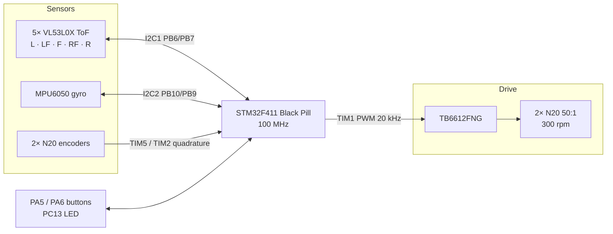
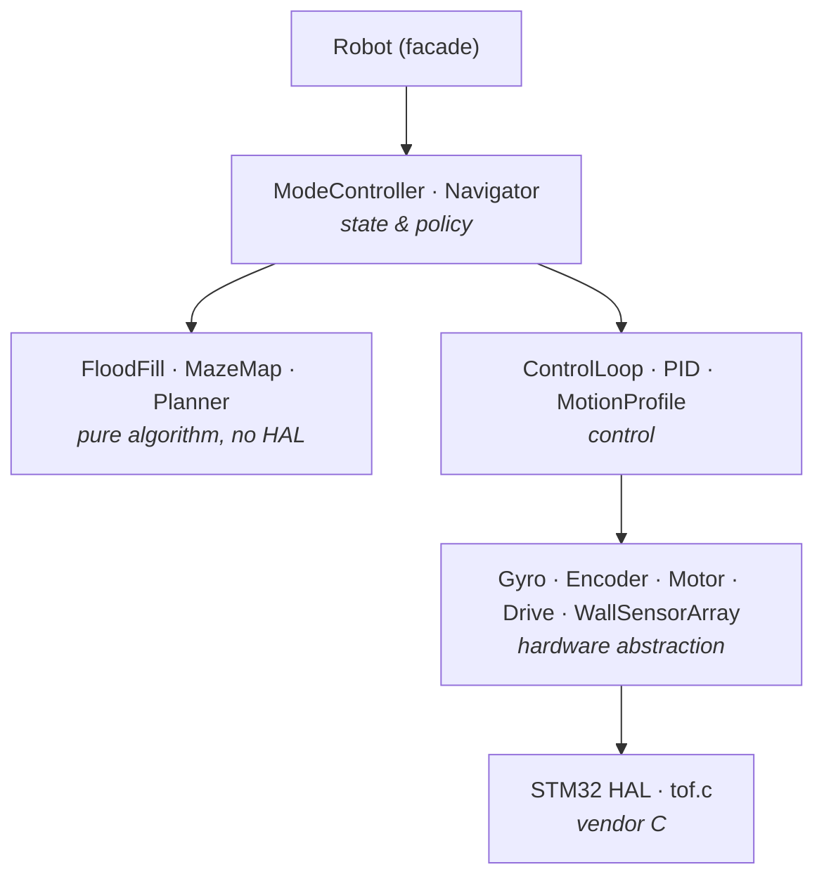
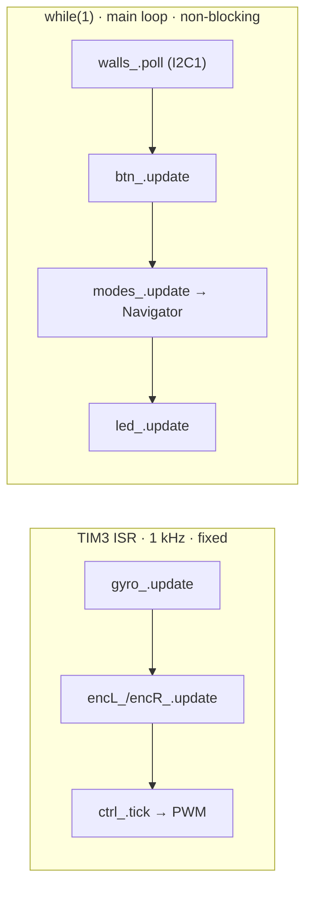
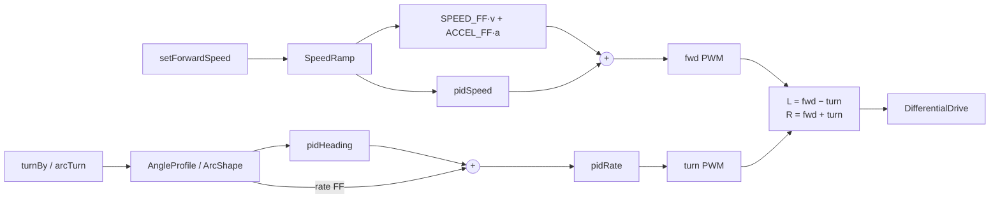
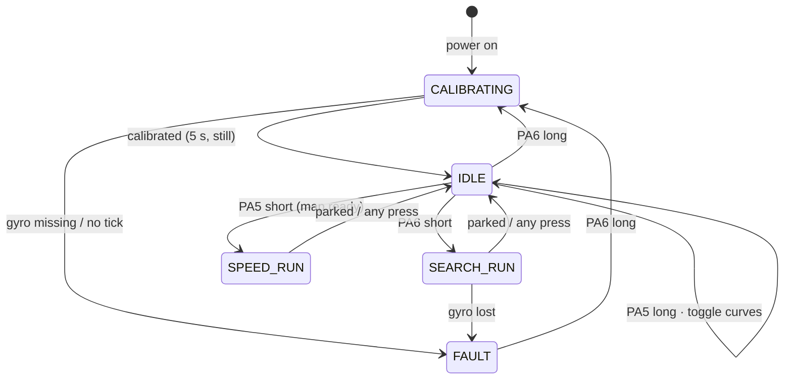
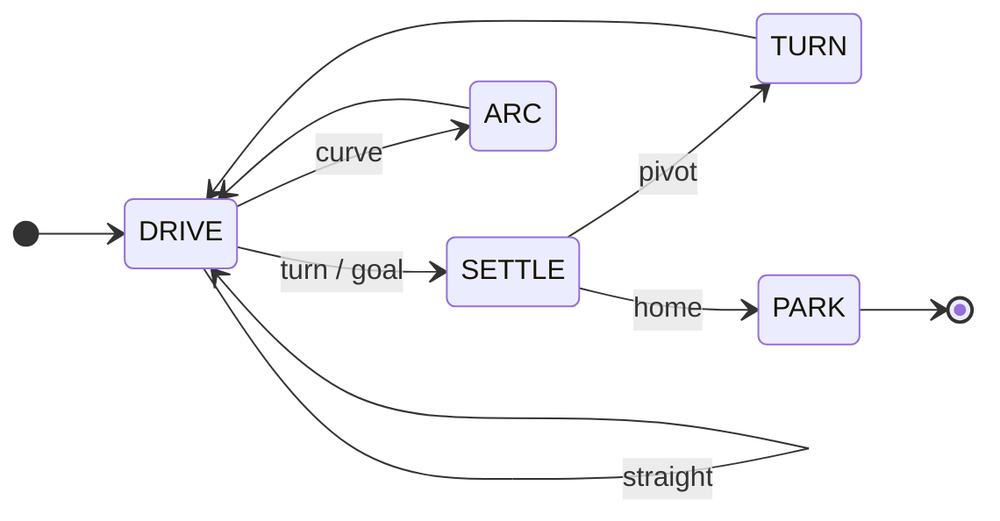
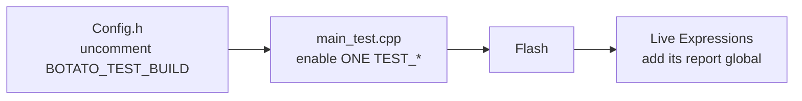

# 🐭 BOTATO — Micromouse Robot
### STM32F411CEU6 · Maze Solver · University of Moratuwa · REV 3.0

16×16 maze solver for ROBOFEST 2026: flood-fill search, speed runs on known cells, curved turns.
C++17 application over the C HAL, built in STM32CubeIDE (or CLion via `CMakeLists.txt`).

| Doc | What's in it |
|---|---|
| [`PINOUT.md`](PINOUT.md) | Pins, buses, timers, clocks, power (hardware ground truth) |
| [`DECISIONS.md`](DECISIONS.md) | Why the firmware is built this way |
| [`mms/README.md`](mms/README.md) | Running the flood fill in the mms simulator |

---

## 1. Hardware



| Part | Qty | | Part | Qty |
|---|---|---|---|---|
| STM32F411CEU6 Black Pill | 1 | | TB6612FNG motor driver | 1 |
| VL53L0X ToF | 5 | | N20 motor + encoder, 50:1 | 2 |
| MPU6050 IMU | 1 | | MP1584EN (6 V motors, 3.3 V logic) | 2 |

Pins and wiring: [`PINOUT.md`](PINOUT.md).

---

## 2. Firmware architecture



Dependencies point down only. `Navigator` sends intentions (`setForwardSpeed`, `turnBy`,
`arcTurn`, `setHeadingTrim`); `ControlLoop` turns them into PWM.

### Two execution contexts



| Interrupt | Priority (set in `Robot::initCore`) |
|---|---|
| SysTick | 0 — must pre-empt TIM3 so HAL I2C timeouts advance |
| TIM3 control loop | 1 |

### Control loop



Gains and caps: `control/ControlConfig.h`. Heading is anticlockwise-positive and never wrapped.

---

## 3. Running the robot



Both buttons together at any time: abort and clear the map. Presses in the first 400 ms of a run
are ignored.

| LED | Meaning |
|---|---|
| Blink 0.5 s | Calibrating — keep still |
| Off / one flash per decision | Idle (normal turns) / running |
| Short flash every second | Idle with curved speed runs |
| Double flash 3 s | Run finished and parked |
| 5 flashes 3 s | Speed run refused: no map yet |
| Repeating 2 / 3 / 4 | Fault: gyro not found / gyro lost / no 1 kHz tick |
| Solid | `Error_Handler` (motors zeroed) |

---

## 4. Maze solving



| Phase | What happens |
|---|---|
| DRIVE | Toward the target cell centre; decides 30 mm before it. Straight = extend the segment, no stop |
| SETTLE | Braked onto the centre, waits until still |
| TURN | Pivot ±90° or 180° on the spot |
| ARC | Curve through the corner (known runs with curves on) |
| PARK | At home: face NORTH, reverse into the start cell |

```
 ← segment to the target cell centre →
 axle ●━━━━━━━━━━━━━━━━━━━━━━━━━━━━━━━━━━┿━━ ⊕ centre
                       decision point ──┘  30 mm before: side ToF over the centre
```

- **Search** explores (unknown walls assumed open), reaches the 2×2 goal, returns home, parks.
- **Speed run** uses visited cells only, no sensing, brakes ahead for what ends each straight.
- **Start corner:** `START_X = WIDTH−1` (maze on the left); the other side is detected and fixed.

| `MazeConfig.h` | Value |
|---|---|
| `WIDTH` × `HEIGHT` | 16 × 16 |
| `START_X`, `START_Y` | `WIDTH−1`, 0 (y = 0 is the bottom row) |
| Goal box | x 7–8, y 7–8 (any cell inside counts) |

---

## 5. Bench tests



| Test | Report | Setup |
|---|---|---|
| `TEST_I2C_GYRO` / `TEST_I2C_TOF` / `TEST_TOF_SINGLE` | `i2cGyro` / `i2cToF` / `tof1` | Bus bring-up only |
| `TEST_TOF_LIVE` | `tofLive` | Between two walls |
| `TEST_TOF_CAL` | `tofCal` | Barrier; PA5 next, PA6 capture |
| `TEST_GYRO` / `TEST_ENCODER` / `TEST_BUTTONS` | `gyroTest` / `encTest` / `btnTest` | Hand tests |
| `TEST_MOTOR` | `motorTest` | **Wheels off the ground** |
| `TEST_HEADING_HOLD` / `TEST_TURN` | `holdTest` / `turnTest` | Floor |
| `TEST_DRIVE_CELLS` / `TEST_CURVE` | `cellTest` / `curveTest` | Open floor, tape |
| `TEST_NAV` | `navTest` | In the maze |

Field meanings: `Core/App/tests/Tests.hpp`. Competition build: watch `robot.navigator_.tel`.

---

## 6. Tuning

Values marked `TUNE(...)` in the config headers. Run the test, copy the field.

| Value | Test → field |
|---|---|
| `WHEEL_DIAMETER_MM` | `TEST_ENCODER` → `encTest.suggestedWheelDiaMm` (push `ENC_PUSH_MM` on a ruler) |
| `CELL_TRAVEL_ADJUST_MM` | `TEST_DRIVE_CELLS`: `192 × cellTest.travelledMm / tape − 192` |
| `SPEED_FF`, `MOTOR_TAU_S` | `TEST_MOTOR` → `suggestedSpeedFF`, `tauMs / 1000` |
| `DEADBAND` | `TEST_MOTOR`: raise if a wheel stalls, lower if jerky |
| `CAL_A`, `CAL_B` | `TEST_TOF_CAL` → `tofCal.fitA`, `fitB` (barrier 30–200 mm) |
| `WC_SUM_CENTERED_MM`, `WC_CENTER_TRIM_MM` | `TEST_TOF_LIVE`, centred → `sideSum`, `sideDiff` |
| Wall thresholds | `TEST_TOF_LIVE`: wall ~60 / none ~250 (side), ~74 / ~266 (front) |
| `FRONT_LATENCY_S` | Maze: raise if fast stops end too close |
| `ARC_START_ADVANCE_MM` | Maze: + if curves start late, − if early |

**Curve shape (`TEST_CURVE`)** — compare where the axle stops with the mark
(`expectForwardMm` ahead, `expectSideMm` aside):

```
          mark ✚                    axle past the mark  → too wide  → raise ARC_TURN_FF_GAIN / LEAD
           ↑                        axle short of mark  → too tight → lower ARC_TURN_FF_GAIN
   lead-out│                        pass: arcMaxLagDeg < 5°, arcEndErrDeg < 3°
     ╭─────╯ curve
     │ lead-in
   start ●
```

---

## 7. Code style

`Core/App/**` and `main_test.cpp` only (CubeMX files stay as generated). Format with
`clang-format -i` (repo `.clang-format`).

| Where | Form |
|---|---|
| File top | `/** @file Name  @brief one line */` |
| Class / struct | `/** … */`, ≤ 3 lines |
| Section | `// ---- Name ----…` to column 80 |
| Declaration | trailing `// unit · meaning` |
| Tunable | trailing `// TUNE(TEST_X): …` or `TUNE(maze): …` |
| Rationale | in `DECISIONS.md`, referenced as `(#n)` |

---

*BOTATO — Department of Computer Science & Engineering, University of Moratuwa · REV 3.0*
