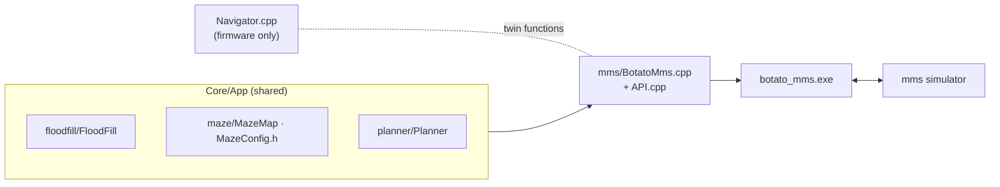
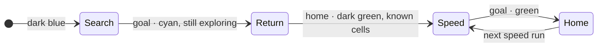

# BOTATO in mms

Runs the firmware's flood fill in [mms](https://github.com/mackorone/mms) (the Micromouse
Simulator). Nothing is copied: the build compiles the maze code straight from `Core/App`.

Change a shared file, press **Build** in mms, and the simulator runs the new code.

## Set up (once)

Mouse → **+**:

| Field | Value |
|---|---|
| Name | `BOTATO` |
| Directory | `C:\New volume\Botato\MicroMouse\Botato-M2\mms` |
| Build Command | `cmd /c build.bat` |
| Run Command | `cmd /c botato_mms.exe --mirror` |

Load a 16×16 classic maze, then **Build** and **Run**. `build.bat` uses `g++` from PATH, else
CLion's MinGW.

| Option | Effect |
|---|---|
| `--mirror` | Maze on the robot's **left** (ROBOFEST 2026, `START_X = WIDTH−1`) |
| *(none)* | Maze on the right; exercises start-corner detection |
| `--speed-runs N` | Speed runs after the search (default 1) |
| `--no-text` | Don't draw flood distances (faster) |

## Run order (same as the robot)

**Reset** in mms = lifting the robot back to the start: the map is kept. Numbers on the map are
flood distances; the log shows cells, turns and decisions per leg.

## Keeping it in sync

| You change | Also do |
|---|---|
| FloodFill / MazeMap / MazeConfig / Planner | nothing |
| Search policy in `Navigator.cpp` | same change in the `>>> twin of Navigator::…` functions |
| FloodFill's public API (`toGoal`, `toCell`, `nextDir`, `distance`) | update the calls in `BotatoMms.cpp` |
| A new source file FloodFill needs | add it to `build.bat` / `build.sh` |
